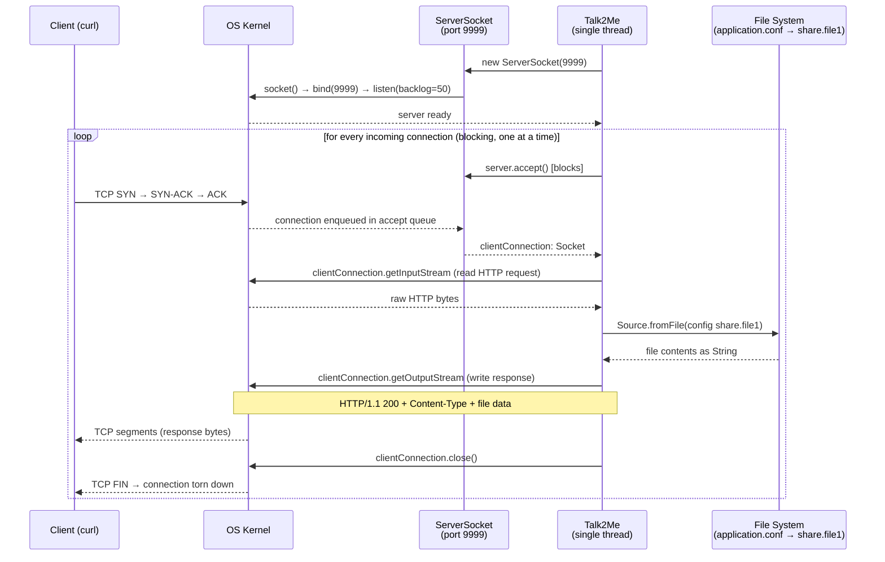

Talk 2 Me
---------

This is a simple scala socket that returns a file to the connecting
client

I created this as a need in a team I was working with where
a team-mate needed a authentication token that expires every 20 mins


## How it works



> **Note:** the `while(true)` loop is single-threaded and blocking — each
> connection is fully handled before the next `accept()` call, so concurrent
> clients queue up in the OS accept backlog.


run server
----------

```bash
sbt run
```

talk to me
----------

```bash
curl -XGET 10.11.208.248:9999
```

